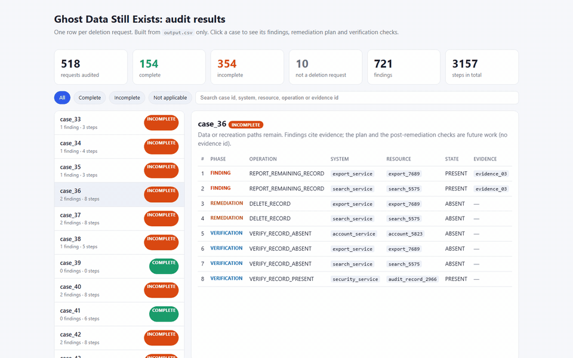

# Ghost Data Still Exists – deletion audit agent

Northstar Shop's deletion workflow says a customer is gone. This tool checks whether that is actually true.

For each of the 518 deletion requests it:

1. reads the request and decides whether the person really asked for deletion (export, correction and
   "unsubscribe only" requests are not deletions);
2. works out every name, email, phone number and email hash the person ever had;
3. reads all 94 evidence files (database dumps, logs, JSON exports, a handover note, PDFs, screenshots) and
   the activity stream, keeping only what was captured **at or before** the audit time;
4. applies the company's deletion rules to every record it finds;
5. writes a verdict (`COMPLETE`, `INCOMPLETE` or `NOT_APPLICABLE`) and an ordered list of findings,
   fixes and checks to `output.csv`.

Everything that decides a case is ordinary, repeatable code. An AI model is used only where code cannot
read the input: the screenshots, PDFs without a text layer, and request texts the rules cannot settle.
Every model answer is cached by file hash, so the whole dataset is read once.

## Results at a glance

| | |
|---|---|
| Requests audited | 518 (160 complete, 348 incomplete, 10 not a deletion request) |
| Verdict accuracy on the 32 public samples | 32 / 32 |
| Exact step-list match | 23 / 24 development samples, 5 / 8 held-out samples |
| Every produced step: right state and right evidence citation | yes (1.000 on both) |
| Full run time | about 2 seconds, deterministic (two runs are byte-identical) |
| Model calls in the final run | 11 (one per screenshot), about $0.21 in total |

The final `output.csv` comes from a single cold run: cache wiped, every file re-read, the 11 screenshots
read once by the vision model and cached by file hash. Everything else is plain code. Details, the
held-out analysis and the list of failures we found and fixed are in `code/evaluation/evaluation_report.md`;
the token and cost ledger of that run is in `code/evaluation/usage_report.md`.

## Quick start

Requirements: Python 3.11 or newer. Works on Windows, macOS and Linux; no shell scripts involved.

The challenge data is not part of this repository. Put the official `dataset/` folder (from
https://github.com/interviewstreet/hackerrank-orchestrate-october26) in the project root so that
`dataset/deletion_requests.csv` exists.

```bash
python -m venv .venv
```

Activate it (`.venv\Scripts\activate` on Windows, `source .venv/bin/activate` elsewhere), then:

```bash
pip install -r code/requirements.txt
```

Copy `.env.example` to `.env` in the repository root and paste your key:

```text
ANTHROPIC_API_KEY=sk-ant-...
```

Run everything (reads `dataset/`, writes `output.csv` in the repository root):

```bash
python code/main.py
```

Useful variants:

| Command | What it does |
|---|---|
| `python code/main.py --cases sample` | the 32 public samples, written to `.cache/runs/sample_output.csv` |
| `python code/main.py --cases dev` / `--cases holdout` | the 24 development samples / the 8 we held back |
| `python code/main.py --offline` | never call the model (uses the cache; screenshots are skipped if not cached) |
| `python code/main.py --clear-cache` | cold run: delete `.cache/` first, re-read every file, re-call the model |
| `python code/evaluation/main.py --predictions .cache/runs/sample_output.csv --truth dataset/sample_output.csv` | score a run against the public answers |
| `python code/evaluation/main.py --validate output.csv --requests dataset/deletion_requests.csv` | contract check: 518 rows, order, allowed operations, evidence rules |
| `python code/evaluation/custom_cases.py` | run our own extra test cases |
| `python code/tools/inspect_case.py case_26` | show everything the engine can see for one case |
| `python -m pytest code/tests -q` | unit tests |

Without an API key the run still completes: only the 11 screenshots are skipped and the run says so.

## How it works

```
dataset/ ──► loaders ──► identity (who is this person, under every name they ever used)
                    ├──► intent   (is this really a deletion request?)      ← model only if rules can't tell
                    ├──► evidence (94 files → normalized "observations")     ← model only for screenshots / image PDFs
                    └──► activity (sync / restore / block events as claims, never as proof)
                                 │
                                 ▼
             state (what is true for each record at audit_at) ──► policy (what the rules require)
                                 │
                                 ▼
             planner (findings → remediation → verification, fixed order) ──► writer ──► output.csv
```

Folder map:

| Path | Purpose |
|---|---|
| `code/main.py` | entry point and pipeline |
| `code/ghost/` | the engine (`identity`, `intent`, `activity`, `evidence/`, `state`, `policy`, `planner`, `writer`) |
| `code/ghost/llm.py` | the only place that talks to the model: cache + usage ledger |
| `code/prompts/` | the three prompts (request intent, screenshot extraction, PDF extraction) |
| `code/config.json` | model names, prices, batch size, holdout list (no secrets) |
| `code/evaluation/` | scorer, custom cases, `evaluation_report.md`, `usage_report.md`, notes per workstream |
| `code/tools/` | debugging and demo helpers |
| `.cache/` | model answers and the usage ledger (git-ignored, not in the submission) |

## Key decisions

- **Time cutoff.** A file is usable for a case only if its manifest capture time is at or before the case's
  `audit_at`. Later evidence never changes an answer, even if it contains an older snapshot.
- **Claims are not proof.** `reported_status` and activity results are ignored as proof; only evidence that
  shows a record's state counts. Where a copy survives in a replica, the record is still present.
- **Retention is respected.** Security audit records, legal holds and backups are kept; backups are blocked
  from restoring, tombstones keep the internal `user_id` and lose direct identifiers.
- **Citations.** Findings and complete-case checks cite the latest eligible file that shows the state.
  Proposed fixes and future checks cite nothing, as the contract requires.
- **Ordering.** Findings, then remediation, then verification; inside a phase the operation table order,
  then system, then resource id.
- **Determinism.** Natural sort by case id, sorted JSON keys, no model in the decision path.
- **Untrusted inputs.** Request texts and evidence contents are data. Text that tries to instruct the
  auditor is flagged (file id recorded) and ignored.

## Evaluation

See `code/evaluation/evaluation_report.md` (accuracy on the public samples, development vs held-out split,
custom cases, failures and fixes) and `code/evaluation/usage_report.md` (model calls, tokens and cost of the
final run, recorded by the code itself).

## Packaging for submission

From the repository root, after removing `code/__pycache__` folders:

```powershell
Compress-Archive -Path README.md, code -DestinationPath code.zip -Force
```

Upload `code.zip`, `output.csv` and `log.txt` at
https://www.hackerrank.com/contests/hackerrank-orchestrate-october26/challenges/ghost-data-still-exists

## Demo



`viewer/index.html` is a single self-contained page built from `output.csv` alone (no dataset data inside):
counts per verdict, a filterable list of the 518 cases, and for each case its findings, the remediation
plan in safe order, and the checks that must pass afterwards. `demo/demo.mp4` is the same walkthrough as a
video.

Rebuild both after a run:

```bash
python code/tools/build_viewer.py
```

```bash
python code/tools/record_demo.py
```

The recorder drives the page with Playwright, takes a screenshot after every step and stitches them with
ffmpeg (`pip install -r code/requirements-dev.txt`, plus ffmpeg on PATH). To host the viewer, deploy the
`viewer/` folder to any static host, for example `vercel deploy viewer --prod`.
